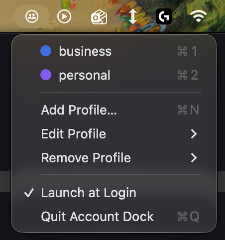
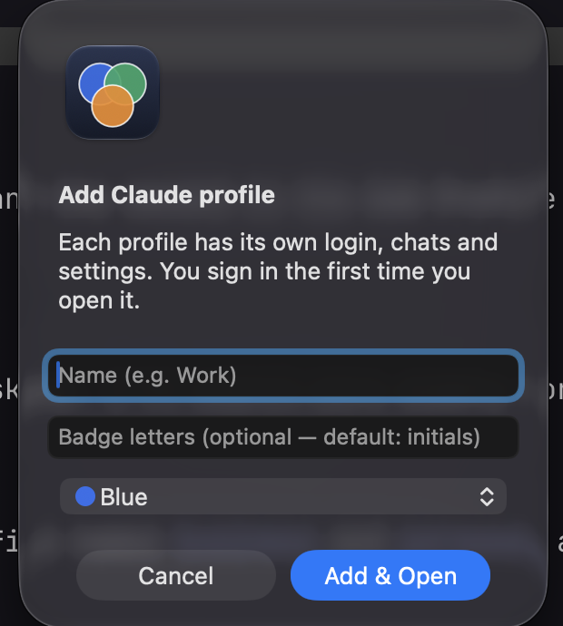

# Account Dock

A tiny macOS menu-bar app for running several Claude Desktop accounts side by side.
Each profile is a separate data folder passed to Claude Desktop via Electron's
`--user-data-dir`, so every profile has its own login, chats and settings.

Each profile also gets its **own copy** of `Claude.app` in `~/Applications` (an APFS clone, so almost no
extra disk) with its own bundle ID and a coloured badge with initials on the icon. That makes every
profile a separate, recognisable Dock icon. `/Applications/Claude.app` itself is never modified and
keeps auto-updating normally.

<p>
  
  &nbsp;&nbsp;
  
</p>

> **Not affiliated with, endorsed by, or sponsored by Anthropic.** "Claude" is a trademark of Anthropic and is
> used here only to say which app this works with. This is an independent hobby tool. It builds a locally
> re-signed copy of an app you already have installed; nothing is downloaded or redistributed, and the
> copies never leave your machine. It relies on Claude Desktop internals that can change at any time, so it
> may stop working after an update. Tested only on macOS 27 with one Claude Desktop version.
>
> **Intended use:** keeping separate accounts you legitimately own (for example work and personal) signed in
> side by side. It is not for evading usage limits, bans or other safeguards, and it does nothing to help
> with that. You are responsible for following Anthropic's terms and usage policy for your accounts.

## Requirements

- macOS 13 or later, Apple silicon or Intel (Account Dock is a universal binary; the Intel half hasn't been tested)
- Claude Desktop installed at `/Applications/Claude.app`
- Xcode or the Command Line Tools (Swift) — only if you build from source

## Install

1. Download `Account-Dock-<version>.dmg` from the project's Releases page.
   Optionally check it: in the folder with the download, run `shasum -a 256 -c Account-Dock-<version>.dmg.sha256`.
2. Open the disk image and drag **Account Dock** into **Applications**.
3. Open it. macOS will warn you the first time — see below.

Then look for the Account Dock icon in your menu bar. On first launch it offers to import the Claude account
you're already signed in to.

### The first-launch security warning

Account Dock is not signed with an Apple Developer ID and is not notarized — that requires Apple's paid
developer programme, which this free hobby project doesn't use. macOS therefore shows a warning for any app
downloaded this way. Depending on your macOS version you'll see *"Account Dock" Not Opened — Apple could not
verify "Account Dock" is free of malware…*, or *"Account Dock" can't be opened because Apple cannot check it
for malicious software*, or *"Account Dock" is damaged and can't be opened*. The app isn't broken. The code is
all in this repository if you'd like to read it, and the DMG's checksum is published next to the download.

To open it, once — pick one way:

**Quickest (Terminal).** This removes macOS's "downloaded from the internet" flag and opens the app:

```sh
xattr -dr com.apple.quarantine "/Applications/Account Dock.app" && open "/Applications/Account Dock.app"
```

(If you put the app somewhere other than Applications, change the path.)

**With clicks.**

1. Double-click **Account Dock**. When the warning appears, click **Done** (not *Move to Bin*, which deletes the app).
2. Open **System Settings → Privacy & Security**. To jump straight there, run
   `open "x-apple.systempreferences:com.apple.preference.security"` in Terminal.
3. Scroll down to **Security** and click **Open Anyway** next to Account Dock. Confirm with your password or
   Touch ID, then click **Open**.
   (On macOS 13–14 you can instead right-click the app → **Open** → **Open**.)

macOS remembers your choice, so this only happens on the first launch (and again if you re-download the app).
Only do this for a copy you got from this project's Releases page.

### Build from source (no warning)

An app you build yourself isn't quarantined, so macOS doesn't warn. Clone this repository, then:

```sh
scripts/build.sh --install     # builds and installs ~/Applications/Account Dock.app
```

To produce the disk image yourself: `scripts/package.sh` writes `dist/Account-Dock-<version>.dmg` and its checksum.

## Use

- **Add Profile…** — name, optional badge letters, colour. Builds the badged copy (about 10–20 s the first
  time) and opens Claude so you can sign in. Letters default to the initials of the first two words of the
  name: "Work" → **W**, "Side Project" → **SP**. Enter your own (up to two) to override.
- Click a profile to open it, or bring it forward if it's already running. ✓ = running.
- **Edit Profile** — change name, letters or colour. Rebuilds the icon; login and chats are kept.
  The profile must be quit first.
- **Remove Profile** — remove it from the list (and delete its app copy), or also move its data to the Trash.
- **Launch at Login** — toggle (may not register, since the app is only ad-hoc signed).

Profiles are listed in `~/Library/Application Support/Account Dock/profiles.json`; each profile's data
lives in `~/Library/Application Support/Claude-<id>`. Your default Claude profile (`Claude`) is untouched.

### The macOS password prompt

The first time a **new** profile opens, macOS asks for your Mac login password so the profile can use
"Claude Safe Storage" in your Keychain, where Claude keeps its sign-in secret. Each profile is a separate,
locally re-signed copy of Claude, so macOS asks once per copy. Enter your password and choose **Always Allow**.
Account Dock shows a short explanation first (with a "Don't show this again" checkbox) and never sees
your password — the prompt comes from macOS.

### Permissions are per profile

Each profile is its own copy of Claude with its own bundle ID, so to macOS it is a **separate app**. Anything
you grant Claude Desktop (screen recording, accessibility, microphone, file access, …) is *not* inherited: each
profile asks for it on its own, and each shows up as its own entry in System Settings → Privacy & Security.

Removing a profile in Account Dock deletes its app copy, unregisters it and resets its permissions where macOS
allows. System-wide lists such as Full Disk Access can keep a stale entry: remove it with the **−** button there.
Old entries are harmless; their toggles are simply off.

### Import your existing Claude account

The first time you open Account Dock (with no profiles yet), it offers to import the Claude Desktop
account you're already signed in to as your first profile, so you don't have to log in again. You can also
do it later from **Import Current Claude Account…** in the menu.

- It copies your regular Claude data (login, settings, chats) into a new profile — about 200 MB. It skips the
  Cowork VM image, caches and downloaded Claude Code binaries, which are re-downloaded on demand.
- Claude is closed briefly while copying (the app asks first). Your original Claude is only read, never changed.
- The imported profile is a snapshot: after that it and your original Claude drift apart.

## How the badged copy works (and why)

Found by experiment on macOS 27 — each step is required:

1. Own **bundle ID** (`com.anthropic.claudefordesktop.<id>`), otherwise macOS and the Dock treat the copy as the original.
2. Remove `CFBundleIconName` — the icon in `Assets.car` otherwise wins over the replaced `.icns`.
3. **Re-sign ad-hoc** — editing the bundle breaks Anthropic's signature and macOS deletes the app on launch.
4. Drop Anthropic's restricted entitlements (`application-identifier`, `team-identifier`,
   `keychain-access-groups`) — an ad-hoc app carrying them is SIGKILLed at launch.
5. Don't touch `CFBundleName` — Electron finds its helper apps by it.

When Claude updates, the copy's version no longer matches the original; it is rebuilt the next time you
open that profile (while it's not running).

## Known limits

- Copies are rebuilt lazily after a Claude update, not instantly. That path hasn't been exercised against a real update yet.
- If macOS shows a stale Dock icon after an edit, run `killall Dock`.
- The re-signed copy has a different code signature from the original, so macOS may ask for keychain access once.

## Uninstall

1. In Account Dock, use **Remove Profile** for each profile. Choose **Move data to Trash** if you also want that
   profile's sign-in and chats gone (keep the data if you might come back). Removing a profile also deletes its
   app copy from `~/Applications` and clears its permissions where macOS allows.
2. Turn off **Launch at Login** in the menu (or in System Settings → General → Login Items).
3. Quit Account Dock and drag it from Applications to the Trash.
4. Optional leftovers: the profile list in `~/Library/Application Support/Account Dock`, and its saved settings
   (`defaults delete local.account-dock`).

Your regular Claude Desktop and its data are never touched by any of this.

**If you deleted the app without removing the profiles first**, look for what's left and delete what's yours:

```sh
ls -d ~/Applications/Claude\ \(*\).app              # one badged copy per profile
ls -d ~/Library/Application\ Support/Claude-*         # one data folder per profile (sign-in and chats)
```

Review the lists before deleting anything — the data folders hold each profile's sign-in. Stale entries in
System Settings → Privacy & Security can be removed with the **−** button.

## License

[MIT](LICENSE)
